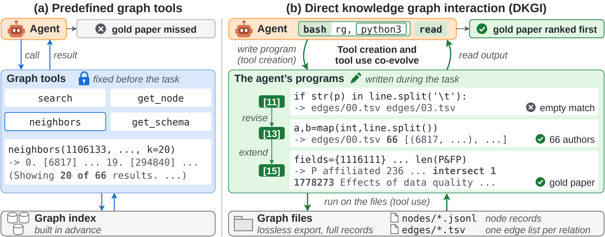

<div align="center">

<h2>Knowledge Graphs as Files:<br>An Agent Harness Where Tool Creation<br>and Tool Use Co-Evolve</h2>
<p><em>Let agents build the tools they need to search knowledge graphs.</em></p>

<p>
  <a href="https://yuyangbai.com/">Yuyang Bai</a><sup>1</sup>,
  <a href="https://yuwang0103.github.io/">Yu Wang</a><sup>2</sup>,
  <a href="https://yuzhimanhua.github.io/">Yu Zhang</a><sup>1</sup>
</p>
<p><sup>1</sup>Texas A&amp;M University &nbsp; <sup>2</sup>University of Georgia</p>

<p>
  <a href="https://arxiv.org/abs/2610.18616"></a>
  <a href="https://yuyangbai.com/dkgi/"></a>
  <a href="https://github.com/leopoldwhite/DKGI"></a>
  <a href="https://huggingface.co/collections/yuyangbai/dkgi"></a>
</p>

<p>
  <a href="#overview">Overview</a> &nbsp;·&nbsp;
  <a href="#results">Results</a> &nbsp;·&nbsp;
  <a href="#quickstart">Quickstart</a> &nbsp;·&nbsp;
  <a href="#official-model-apis">Model APIs</a> &nbsp;·&nbsp;
  <a href="#reproduction">Reproduction</a> &nbsp;·&nbsp;
  <a href="#citation">Citation</a>
</p>

</div>

## Overview

**Direct knowledge graph interaction (DKGI)** lets language model agents write and revise graph-access tools
directly over complete node and edge files. The agent interleaves Python, shell search and file inspection:
execution feedback guides code revisions, and the evolving code guides the next search.



*Tool creation and tool use co-evolve during graph search. In this STaRK-MAG example, DKGI extends its search over
the graph files and ranks the gold paper first.*

The repository contains graph export code, runners for Full DKGI and its controlled variants, closed-book probes,
exact prompts, and scripts for the paper's analysis. The exported graphs and recorded test trajectories are hosted
on Hugging Face.

### Why DKGI?

- **Graphs as files.** Inspect complete node and edge files with Python, shell search and file tools.
- **Tools evolve during a task.** Revise graph-access code using execution feedback rather than a fixed tool API.
- **Training-free evaluation.** Evaluate on 7,108 STaRK synthetic test queries, with controlled variants and recorded trajectories.

## Results

Hit@1 (%) on the three STaRK synthetic test sets, covering 7,108 queries:

| Method | Amazon | MAG | Prime |
|:--|--:|--:|--:|
| GRASP (published baseline) | 71.2 | 82.8 | 67.8 |
| DKGI (Pi, GPT-6-Luna) | 57.8 | 88.0 | 63.8 |
| DKGI (Codex, GPT-6-Luna) | 59.8 | 88.0 | 66.6 |
| **DKGI (Pi, GPT-6-Astra)** | **79.4** | **91.8** | **74.5** |

Training-free DKGI with GPT-6-Astra improves over GRASP by **8.2 / 9.0 / 6.7** Hit@1 points on Amazon / MAG / Prime.
Baseline numbers are published results with different backbones, budgets and evaluation code. See the
[paper](https://arxiv.org/abs/2610.18616) for Recall@20, MRR and controlled ablations.

## Quickstart

Clone into a short path on **Linux**:

```bash
git clone https://github.com/leopoldwhite/DKGI.git ~/dkgi
cd ~/dkgi
```

### 1. Install the harnesses

Complete the [Linux harness and dependency setup](docs/setup.md#requirements), including **Pi 0.65.0** and
**Codex CLI 0.156.1**. The runners preserve the released prompts, isolation and experiment commands.

### 2. Download the graphs and check offline

```bash
hf download yuyangbai/DKGI-STaRK-Graphs --repo-type dataset --local-dir experiments/stark \
  --include "corpus/*" "public/*" "private/*" "prepared/*"
python3 experiments/stark/use_downloaded_graphs.py
python3 experiments/stark/dci_run/run.py pi_full_test --check --datasets prime
```

`--check` validates prompts, harness wiring and execution isolation without a model call or API key.

## Official model APIs

| Harness | OpenAI | Anthropic |
|:--|:--|:--|
| Pi | Responses API | Messages API |
| Codex | Responses API | Unsupported; fails before execution |

Choose **one** provider and replace the placeholders with a model available to your account and its API key:

```bash
# OpenAI — Pi or Codex
export MODEL_PROVIDER=openai
export MODEL_NAME="YOUR_OPENAI_MODEL"
export OPENAI_API_KEY="YOUR_OPENAI_API_KEY"
```

```bash
# Anthropic — Pi
export MODEL_PROVIDER=anthropic
export MODEL_NAME="YOUR_ANTHROPIC_MODEL"
export ANTHROPIC_API_KEY="YOUR_ANTHROPIC_API_KEY"
```

Requests use the official `https://api.openai.com/v1` or `https://api.anthropic.com` endpoints.
[Provider configuration and capability scope](docs/setup.md#environment-variables) describes the harness integration.
Keep real keys out of source files and committed configuration.

### Run a small live check

```bash
python3 experiments/stark/dci_run/run.py pi_full_test --smoke --datasets prime --workers 1
```

This makes paid model requests for **two questions**. Changing the provider or model creates a new experimental
configuration; the reported paper results above are retained, and these instructions do not claim a new benchmark rerun.

## Reproduction

Portable provider checks use synthetic fixtures without network access or credentials:

```bash
python3 -m unittest discover -s tests -v
```

[Reproduction instructions](docs/reproduction.md) cover full runs, controlled variants, result locations and analysis.
The [configuration map](docs/reference.md#names-used-in-the-paper-and-in-the-code) connects paper settings to the
released presets. Use the same model, prompts, budgets and evaluation setup to compare with a paper configuration.

## Documentation and data

| Guide or resource | Contents |
|:--|:--|
| [Setup and data](docs/setup.md) | Linux requirements, pinned dependencies, official provider configuration and graph preparation |
| [Reproduction](docs/reproduction.md) | Offline checks, experiment commands, trajectory locations and analysis |
| [Repository reference](docs/reference.md) | Code layout, paper-to-code configuration map and text-constraint tags |
| [Exact prompts](prompts/README.md) | Final prompt, controlled variants, probes and annotation instructions |
| [Exported graphs](https://huggingface.co/datasets/yuyangbai/DKGI-STaRK-Graphs) | Node and edge files, questions and labels for Amazon, MAG and Prime |
| [Test trajectories](https://huggingface.co/datasets/yuyangbai/DKGI-Trajectories) | Recorded trajectories, answers and scores; prompt-validation rounds are excluded |

## Citation

```bibtex
@misc{bai2026knowledgegraphsfilesagent,
      title={Knowledge Graphs as Files: An Agent Harness Where Tool Creation and Tool Use Co-Evolve},
      author={Yuyang Bai and Yu Wang and Yu Zhang},
      year={2026},
      eprint={2610.18616},
      archivePrefix={arXiv},
      primaryClass={cs.CL},
      url={https://arxiv.org/abs/2610.18616},
}
```

## License

Code is released under [MIT](LICENSE). Derived graph data, text-constraint tags, prompts and the trajectories on
Hugging Face are released under [CC BY 4.0](LICENSE-DATA.md). Third-party dependencies retain their own licenses;
the patch and overlay files in `third_party/` are MIT-licensed.
